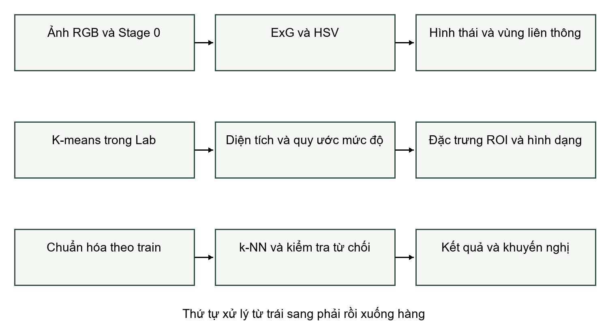
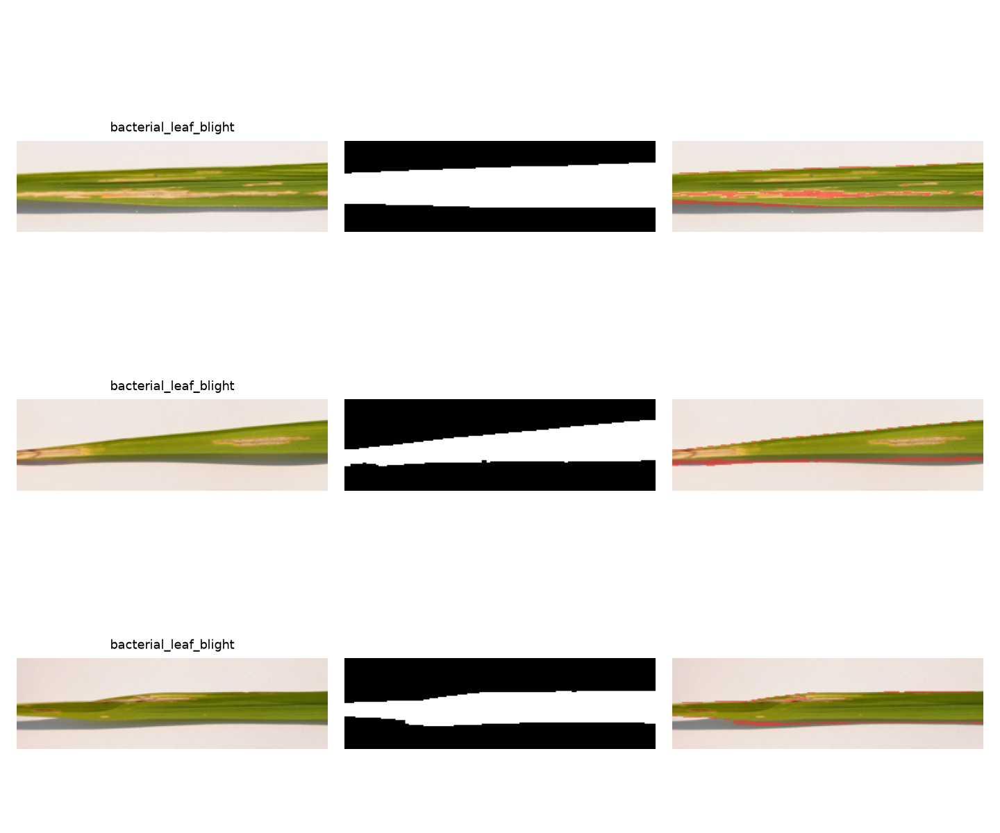

## Phân tích bệnh lá lúa và cà phê từ ảnh điện thoại

BÁO CÁO BÀI TẬP LỚN MÔN XỬ LÝ ẢNH

Phương pháp truyền thống với ExG và HSV, K-means trong Lab, đặc trưng màu và kết cấu, phân lớp k-NN

Trường và khoa   [Nhóm điền theo mẫu của đơn vị]

Lớp học phần   [Nhóm điền]

Giảng viên hướng dẫn   [Nhóm điền]

Nhóm thực hiện   [Tên nhóm và năm thành viên]

Đề tài theo yêu cầu riêng về bệnh lá lúa và cà phê

Tháng 11 năm 2026

Phạm vi kết quả hiện tại: thực nghiệm phân lớp trên ảnh lúa UCI. Khung xử lý hỗ trợ cả hai cây; thực nghiệm cà phê, ảnh tự chụp và nhãn pixel được hoàn thiện sau khi nhóm bổ sung dữ liệu thật.

---

### Tóm tắt và cam kết học thuật

Báo cáo trình bày một hệ thống phân tích ảnh lá bằng xử lý ảnh truyền thống. Hệ thống tách lá theo màu và hình thái học, gom cụm pixel lá trong không gian Lab để tạo vùng nghi tổn thương, ước lượng tỷ lệ diện tích và trích đặc trưng phục vụ phân lớp. Ứng dụng Streamlit hỗ trợ chụp hoặc tải ảnh, hiển thị các bước và xuất mặt nạ cùng kết quả JSON.

Thực nghiệm ban đầu gồm 90 ảnh huấn luyện và 30 ảnh kiểm tra của bộ Rice Leaf Diseases. k-NN tự cài đạt accuracy 63.3% và macro-F1 0.6284. Đây là đánh giá trên ảnh nền trắng, với nhóm chia theo ảnh vì nguồn chưa có định danh cây hoặc phiên chụp. Kết quả chưa chứng minh khả năng tổng quát ngoài đồng.

Các thuật toán lõi được cài bằng NumPy và kiểm chứng theo cùng quy ước với thư viện. Phép thử thay đổi độ sáng cho thấy độ chính xác giảm mạnh, là bằng chứng cần thu dữ liệu đa điều kiện và cải thiện độ bền ánh sáng trước khi ứng dụng thực địa. Các ngưỡng phân mức là quy ước kỹ thuật, chưa được hiệu chuẩn theo thang nông học.

### Cam kết cần được nhóm xác nhận

Nhóm chịu trách nhiệm về dữ liệu thu thập, nhãn bệnh, nội dung giải thích và số liệu nộp cuối. Không sử dụng ảnh mạng để thay ảnh tự chụp; không gọi mặt nạ tự sinh là nhãn tay; không tạo chữ ký hoặc lịch sử commit hồi tố. Mọi số liệu thực nghiệm có đường dẫn tới manifest và tệp kết quả tương ứng.

Đại diện nhóm xác nhận sau khi kiểm tra   [Họ tên và chữ ký thực tế]

---

### Phân công thực hiện và minh chứng

Bảng phân công sau là kế hoạch đề xuất cho nhóm năm người. Tỷ lệ đóng góp và chữ ký được ghi sau khi đối chiếu công việc thực tế, không mặc định mỗi người đã hoàn thành phần việc được giao.

Bảng mở đầu 1 Phân công dự kiến

| Vai trò | Mã và nhiệm vụ | Nội dung báo cáo |
|---|---|---|
| TV1 [Tên] | app.py, tích hợp, quản lý repo | Chương 1, kiến trúc, Chương 5 |
| TV2 [Tên] | Lý thuyết và kiểm chứng | Chương 2, mục kiểm chứng |
| TV3 [Tên] | HSV, Lab, hình thái, K-means | Phân đoạn trong Chương 3 |
| TV4 [Tên] | LBP, GLCM, k-NN, đối chiếu SVM | Đặc trưng và phân lớp |
| TV5 [Tên] | Dữ liệu, nhãn tay, thí nghiệm | Chương 4 và biểu đồ |

Minh chứng gồm commit thật theo tài khoản từng thành viên, nhật ký họp, ảnh gốc và hồ sơ nguồn dữ liệu. Các tệp nhat_ky_nhom.csv và danh_gia_cheo.csv trong thư mục docs cung cấp cấu trúc ghi chép. Thành viên chỉ ký xác nhận sau khi đọc và hiểu các phần liên quan.

Đánh giá cá nhân nên xét chất lượng công việc, khả năng giải thích và mức tham gia thực nghiệm, thay vì chỉ đếm số dòng mã. Mỗi người cần tự chạy toàn bộ pipeline và trả lời được câu hỏi cơ bản về phần của thành viên khác.

Thời gian trong hướng dẫn có hai mốc 3 tuần và 8 tuần. Nhóm cần theo lịch giảng viên xác nhận và ghi nhật ký thực tế. Báo cáo không diễn giải một phiên chuẩn bị mã thành quá trình làm việc đã kéo dài nhiều tuần.

---

### Mục lục và danh mục ký hiệu

Chương 1 Tổng quan bài toán   6

Chương 2 Cơ sở lý thuyết   9

Chương 3 Thiết kế và cài đặt   14

Chương 4 Thực nghiệm và đánh giá   21

Chương 5 Kết luận và hướng phát triển   31

Tài liệu tham khảo   33

Phụ lục Hướng dẫn chạy và hồ sơ nhóm   36

Các tiêu đề có cấu trúc Heading trong Word để cập nhật mục lục tự động sau khi nhóm chỉnh sửa. Số trang của bản PDF dùng bộ đếm ở chân trang.

Bảng mở đầu 2 Ký hiệu dùng trong báo cáo

| Ký hiệu | Ý nghĩa |
|---|---|
| M, N, P | Chiều cao, chiều rộng và số pixel ảnh |
| L, D | Mặt nạ lá và mặt nạ vùng nghi tổn thương |
| K, T, μj | Số cụm, số vòng lặp và tâm cụm thứ j |
| r, s | Tỷ lệ diện tích và độ lệch chuẩn chuẩn hóa |
| h, q, G | Histogram, mức xám lượng tử và GLCM |
| k, d | Số láng giềng và số chiều đặc trưng |
| TP, FP, FN | Dương tính đúng, dương tính sai và âm tính sai |

---

### Danh mục hình và bảng

Hình 3.1 Luồng phân tích một ảnh lá     14

Hình 4.1 Ma trận nhầm lẫn k-NN trên 30 ảnh test     25

Hình 4.2 Ảnh test cùng mask lá và overlay     26

Hình 4.3 Đối chiếu phương pháp tách lá trên train     30

Bảng 1.1 Đầu vào đầu ra và ràng buộc     7

Bảng 1.2 Vị trí của các hướng tiếp cận     8

Bảng 2.1 Ví dụ tính tay K-means     12

Bảng 3.1 Cấu trúc mã nguồn     15

Bảng 3.2 Chi phí tính toán     19

Bảng 3.3 Sai số đối chiếu cùng quy ước     20

Bảng 4.1 Phiên bản thư viện đã dùng     21

Bảng 4.2 Phân bố dữ liệu lúa     21

Bảng 4.3 Kết quả phân lớp trên cùng dữ liệu     23

Bảng 4.4 Macro-F1 năm fold theo cấu hình     24

Bảng 4.5 Stress độ sáng mờ và xoay     27

Bảng 4.6 Trạng thái dữ liệu cần bổ sung     28

Bảng 4.7 Accuracy v1 và v2 trên cùng test     29

Bảng 4.8 Ablation tiền xử lý trên train CV     29

Bảng 5.1 Kết quả so với mục tiêu     31

Các trang trong danh mục tương ứng bản PDF phát hành cùng mã nguồn. Sau khi bổ sung kết quả thực địa, cập nhật mục lục và danh mục theo bản xuất mới.

---

## Chương 1 Tổng quan bài toán

### 1.1 Bối cảnh và tình huống sử dụng

Trong một tình huống tại ruộng lúa hoặc vườn cà phê, người trồng nhận thấy lá xuất hiện đốm nâu, vùng vàng hoặc phần mô khô. Ảnh điện thoại có thể ghi nhận dấu hiệu để so sánh theo thời gian và hỗ trợ trao đổi với cán bộ kỹ thuật. Bài toán của đồ án là chuyển ảnh đó thành các vùng có thể quan sát, một tỷ lệ diện tích và nhãn phân lớp có điều kiện.

Phát hiện sớm và giảm sử dụng thuốc bảo vệ thực vật là động lực ứng dụng. Đồ án chưa có thử nghiệm can thiệp hoặc theo dõi năng suất, vì vậy không xem các lợi ích này là kết quả đã đo. Màu vàng có thể xuất hiện do bệnh, thiếu dinh dưỡng, già hóa hoặc chiếu sáng; một ảnh đơn không đủ phân biệt chắc chắn mọi nguyên nhân.

Field Shift trong NASA Space Apps 2026 đặt bài toán nông nghiệp trong bối cảnh dữ liệu quan sát Trái Đất [1]. Ảnh lá cung cấp quan sát ở cấp độ gần mặt đất, còn vệ tinh phản ánh trạng thái theo vùng và thời gian. Hai nguồn có thể bổ sung nhau khi có giao thức địa lý và thời gian phù hợp; báo cáo hiện tại chưa tích hợp dữ liệu vệ tinh và không dùng ảnh vệ tinh thay nhãn bệnh trên lá.

Đóng góp kỹ thuật của đồ án nằm ở pipeline giải thích được, thuật toán lõi tự cài và quy trình tái lập. Người học nhìn thấy mặt nạ trung gian, hiểu cách tỷ lệ được tính và truy được từng kết quả về ảnh gốc. Cách tiếp cận này phù hợp mục tiêu môn Xử lý ảnh và tạo mốc so sánh cho mô hình học sâu trong tương lai.

### 1.2 Người dùng và quyết định hỗ trợ

Người dùng demo chọn đúng cây trồng và chụp một lá rõ nét. Kết quả phục vụ sàng lọc và ghi nhận triệu chứng. Khuyến nghị của demo tập trung chụp bổ sung, theo dõi và xác nhận chuyên môn. Mô hình không đưa hoạt chất hoặc liều phun từ một nhãn dự đoán.

---

### 1.3 Phát biểu bài toán và mục tiêu

Bảng 1.1 Đầu vào đầu ra và ràng buộc

| Thành phần | Đặc tả |
|---|---|
| Đầu vào | Ảnh RGB 8 bit JPG/PNG, một lá chủ đạo, cây lúa hoặc cà phê |
| Tiền xử lý | Chuẩn hướng EXIF, cạnh dài tối đa 256 pixel, giữ tỷ lệ ảnh |
| Đầu ra | Mask lá, mask nghi tổn thương, tỷ lệ, mức độ, nhãn hoặc từ chối |
| Tài nguyên | CPU, không yêu cầu GPU; thời gian được đo trên dữ liệu thật |
| Giao diện | Tải ảnh, camera, ảnh mẫu; tải PNG và JSON |
| Tái lập | Seed 42, manifest, cấu hình, phiên bản thư viện và model NPZ |

Mục tiêu thứ nhất là triển khai đủ năm chức năng bắt buộc, cho phép truy vết trung gian và tái sử dụng cùng mã cho hai cây. Mục tiêu thứ hai là kiểm chứng các phép toán có quy ước tương ứng với thư viện. Mục tiêu thứ ba là báo cáo accuracy, macro-F1, IoU và ảnh hưởng điều kiện chụp theo giao thức đã xác định trước.

Tiêu chí hoàn thành dữ liệu gồm ít nhất 100 ảnh do nhóm tự chụp và ít nhất 30 ảnh có mặt nạ tay độc lập cho đánh giá phân đoạn. Bản thực nghiệm ban đầu đáp ứng phần dữ liệu công khai cho lúa; phần thu ảnh và xác nhận nhãn phải được thực hiện tại ruộng hoặc vườn. Các mục còn thiếu được liệt kê theo trạng thái, không thay bằng dữ liệu tổng hợp.

Có thể đăng ký mục tiêu định lượng như macro-F1 tối thiểu 0,80 trên tập test và IoU trung bình tối thiểu 0,50. Đây là mức kỳ vọng thiết kế cần thống nhất trước đánh giá, không phải chuẩn nông học hoặc cam kết hiệu năng ngoài đồng. Khi chưa có mask test thì chưa thể kết luận mục tiêu IoU đạt hay không.

Nhãn được quản lý theo cây. Ví dụ bạc lá thuộc lúa và gỉ sắt thuộc cà phê không tạo thành một taxonomy chung thiếu kiểm soát. Demo không tự suy cây từ ảnh; người dùng chọn cây để tải mô hình tương ứng. Nhãn lạ hoặc mô hình chưa có được hiển thị rõ.

---

### 1.4 Công trình liên quan và phạm vi

Prajapati và cộng sự nghiên cứu phân lớp bệnh lúa với xử lý ảnh và đặc trưng [2]. Mohanty và cộng sự chỉ ra tiềm năng CNN trên dữ liệu lá cây có kiểm soát [3]. Esgario và cộng sự kết hợp nhận dạng stress và ước lượng mức độ trên cà phê [4]. Những công trình này định hướng thiết kế, nhưng dùng dữ liệu và giao thức khác với lần chạy hiện tại.

Bảng 1.2 Vị trí của các hướng tiếp cận

| Hướng | Ưu điểm | Giới hạn cần xét |
|---|---|---|
| Màu và hình thái | Dễ kiểm tra mask, chi phí thấp | Nhạy ánh sáng và nền xanh |
| Đặc trưng và k-NN | Dễ giải thích khoảng cách, ít tham số | Cần chuẩn hóa và dữ liệu đại diện |
| Đặc trưng và SVM | Biên quyết định phi tuyến | Phụ thuộc đặc trưng và C, gamma |
| CNN | Học biểu diễn từ dữ liệu | Cần kiểm tra chuyển miền, dữ liệu và tài nguyên |

Đồ án chọn phương pháp truyền thống làm hệ thống chính để đáp ứng yêu cầu tự cài thuật toán lõi bằng NumPy. SVM dùng thư viện làm đối chiếu. CNN chỉ thuộc hướng phát triển; không mô tả CNN như một mô-đun đã hoàn thành.

Phạm vi hình học là phần lá nhìn thấy trong ảnh hai chiều. Không suy ra diện tích thật theo cm² khi chưa có thước chuẩn, không phục hồi mặt khuất và không đo mức độ toàn cây từ một lá. Lá cuộn, chồng lấp hoặc bị cắt khỏi ảnh có thể làm sai mẫu số của tỷ lệ. Cảnh báo biên hỗ trợ phát hiện một số trường hợp, nhưng không bao phủ tất cả.

Bệnh hỗn hợp, triệu chứng chưa rõ và cây ngoài taxonomy cần quy trình chuyên môn riêng. Cơ chế từ chối giúp giảm ép nhãn nhưng chưa được hiệu chuẩn bằng tập ảnh ngoài phân phối. Vì vậy kết quả phải được diễn giải cùng danh sách lớp đã học và điều kiện dữ liệu.

---

## Chương 2 Cơ sở lý thuyết

### 2.1 Biểu diễn màu và chỉ số xanh

Ảnh sRGB mã hóa phi tuyến có các kênh R, G, B trong [0,255]. Tính toán được chuyển sang số thực trước khi trừ hoặc nhân để tránh tràn số uint8. HSV tách góc màu H, độ bão hòa S và độ sáng V; triển khai dùng H theo độ [0,360), S và V trong [0,1]. Quy ước này khác thang H 8 bit của OpenCV nên không so sánh trực tiếp các giá trị không đổi thang [5].

$$ r = R/(R+G+B+ε),  g = G/(R+G+B+ε),  b = B/(R+G+B+ε);  ExG = 2g−r−b \tag{2.1} $$

ε bảo vệ pixel đen. Vì r+g+b xấp xỉ 1, ExG dương thường gợi ý thành phần xanh trội. Ngưỡng ExG=0,04 và S>0,15 chọn seed xanh. Seed chỉ định hướng vùng lá; nếu dùng seed làm mask cuối, mô lá vàng hoặc hoại tử sẽ bị loại khỏi mẫu số, gây sai tỷ lệ tổn thương.

$$ C = max(R,G,B)−min(R,G,B);  V = max(R,G,B);  S = C/V khi V>0 \tag{2.2} $$

Công thức HSV dùng RGB chuẩn hóa [0,1]; S=0 khi V=0. H tính theo kênh đạt cực đại và lấy modulo 360. Với pixel vô sắc C=0, H được đặt 0. Ngưỡng HSV mở rộng từ H=8 đến 170 độ, S>0,15 và V>0,06 để giữ các màu vàng/nâu có khả năng nối với phần xanh.

CIE Lab bắt đầu bằng tuyến tính hóa sRGB, nhân ma trận sang XYZ D65 và chuẩn hóa theo điểm trắng. Hàm f(t) dùng căn bậc ba khi t>(6/29)³, nhánh tuyến tính ở vùng tối. L*=116f(Y/Yn)−16; a*=500[f(X/Xn)−f(Y/Yn)]; b*=200[f(Y/Yn)−f(Z/Zn)]. L* mô tả độ sáng, a* trục xanh–đỏ, b* trục xanh lam–vàng. Lab không làm ảnh bất biến chiếu sáng; nó chỉ thay cách biểu diễn khoảng cách màu.

---

### 2.2 Hình thái học và bảo toàn vùng lá

$$ A⊖B = {x : Bx ⊆ A};   A⊕B = {x : Bx ∩ A ≠ ∅} \tag{2.3} $$

$$ A∘B = (A⊖B)⊕B;   A•B = (A⊕B)⊖B \tag{2.4} $$

A là tập pixel ứng viên, B là phần tử cấu trúc vuông 3×3 và Bx là phần tử dịch tới x. Co yêu cầu mọi pixel lân cận đúng; giãn yêu cầu ít nhất một pixel đúng. Mở loại nhiễu nhỏ và làm đứt cầu hẹp; đóng nối khe nhỏ. Các phép toán dùng nền False ngoài ảnh. Quy ước biên phải thống nhất khi đối chiếu thư viện [5].

Kích thước phần tử cấu trúc càng lớn thì khử nhiễu mạnh hơn, đồng thời dễ loại lá hẹp và gộp vùng nền. Với lá lúa ở độ phân giải nhỏ, mở 5×5 có thể xóa phần lá mảnh. Vì vậy phiên bản mặc định dùng 3×3 và ghi cấu hình cùng mô hình. Khảo sát kích thước chỉ được điều chỉnh dựa trên train hoặc segval.

Sau hình thái học, thuật toán gán nhãn vùng liên thông 4 láng giềng bằng hàng đợi. Vùng có nhiều seed xanh nhất được giữ lại; nếu không có seed thì chọn vùng màu lớn nhất. Đây là giả định một lá chủ đạo, không phải thuật toán phân biệt từng lá trong tán. Nền cỏ xanh có thể thắng điểm seed và trở thành vùng sai.

Lấp lỗ gán nhãn nền, giữ nền nối với biên ảnh và đổi các thành phần nền kín thành lá. Thao tác này khôi phục các vùng bệnh nằm hoàn toàn trong lá mà ngưỡng màu đã bỏ qua. Nó không khôi phục được mô bệnh nối ra mép ngoài; sai số này cần xem trong đánh giá mask lá và sai số tỷ lệ.

Ví dụ mask 5×5 có khối vuông 3×3 ở giữa và pixel tâm rỗng: thành phần nền ở tâm không chạm biên nên được lấp; diện tích lá tăng từ 8 lên 9 pixel. Lấp lỗ là quyết định hình học, không gán nhãn bệnh cho pixel vừa được lấp. Bước K-means sẽ đánh giá màu của chúng sau đó.

---

### 2.3 K-means và dẫn xuất cập nhật tâm

$$ J = Σj Σx∈Cj ||x−μj||²;   μj = (1/|Cj|) Σx∈Cj x \tag{2.5} $$

Mỗi x là vector Lab của một pixel nằm trong mask lá, Cj là cụm j, μj là tâm và K là số cụm. K-means của Lloyd lặp hai bước gán điểm về tâm gần nhất và cập nhật tâm theo trung bình [6]. Chọn K quá nhỏ có thể trộn màu bệnh với mô khỏe; K quá lớn chia vỡ cùng loại mô và làm quy tắc chọn cụm không ổn định.

Giữ phân hoạch Cj cố định, đạo hàm của J theo μj bằng 2|Cj|μj−2Σx. Cho đạo hàm bằng 0 thu được trung bình cụm. Hessian bằng 2|Cj|I là xác định dương nếu cụm không rỗng, nên trung bình là cực tiểu duy nhất cho bước cập nhật. Với cụm rỗng, mã giữ tâm cũ để tránh chia cho 0.

Ở bước gán, từng điểm chọn tâm có bình phương khoảng cách nhỏ nhất nên J không tăng. Ở bước cập nhật, trung bình tối thiểu hóa J với phân hoạch hiện tại nên J cũng không tăng. J bị chặn dưới bởi 0, do đó dãy giá trị mục tiêu hội tụ. Kết quả này không chứng minh đạt tối ưu toàn cục; khởi tạo có thể đưa tới các nghiệm cục bộ khác nhau.

Triển khai dùng khởi tạo k-means++ và seed 42, tối đa 60 vòng, dừng khi thay đổi tâm lớn nhất dưới 10⁻⁶. Nếu lá có quá nhiều pixel, chọn tối đa 8000 pixel bằng seed cố định để học tâm rồi gán toàn bộ pixel lá về các tâm đó. Thời gian giảm nhưng tâm vẫn là xấp xỉ của bài toán toàn ảnh.

Pipeline chính phân cụm trên a*b* để giảm phụ thuộc trực tiếp vào độ sáng L*. Cụm đông nhất là giả định mô khỏe; chọn cụm xa tâm này nhất nếu khoảng cách ít nhất 8 đơn vị màu. Tham số là mặc định kỹ thuật đã khóa, chưa hiệu chuẩn bằng nhãn tay. Luật Lab theo ngưỡng cũ và Otsu trên a* được giữ làm đối chứng. Không tự gán tác nhân bệnh cho ID cụm.

---

### 2.4 Ví dụ số và tỷ lệ diện tích

Xét ảnh ma trận 4×4 trong Bảng 2.1, mỗi pixel có vector Lab=(L*,0,0) với L* lấy từ ô tương ứng. Chọn K=2 và tâm đầu L* bằng 0 và 8. Vì a*=b*=0 ở mọi điểm, khoảng cách Lab rút về khoảng cách một chiều trên L*. Đây là ví dụ tính tay minh họa thuật toán, không phải dữ liệu bệnh thật.

Bảng 2.1 Ví dụ tính tay K-means trên ảnh 4×4

| Cột 1 | Cột 2 | Cột 3 | Cột 4 |
|---|---|---|---|
| 0 | 0 | 8 | 8 |
| 0 | 2 | 8 | 10 |
| 0 | 2 | 8 | 10 |
| 2 | 2 | 10 | 10 |

Bước gán: các giá trị 0 có d²=(0,64), giá trị 2 có d²=(4,36), giá trị 8 có d²=(64,0), giá trị 10 có d²=(100,4). Vì vậy tám pixel ở hai cột trái thuộc cụm 1, tám pixel còn lại thuộc cụm 2. Bước cập nhật: μ₁=(4×0+4×2)/8=1 và μ₂=(4×8+4×10)/8=9. Gán lại không đổi; mỗi pixel lệch tâm một đơn vị nên SSE=16. Ví dụ đã kiểm chứng bằng NumPy trong tests/test_core.py. Phép đối chiếu K-means thư viện với cùng khởi tạo nằm trong scripts/verify_algorithms.py.

$$ r = |D∩L|/|L|;   phần trăm tổn thương = 100r \tag{2.6} $$

L là mask lá dự đoán, D là vùng nghi tổn thương dự đoán. Mã ràng buộc D⊆L trước khi đếm, kiểm tra mask lá không rỗng và không dùng hình chữ nhật bao quanh lá làm mẫu số. Nếu |L|=1000 và |D|=120 thì r=0,12 tương ứng 12%, thuộc mức trung bình theo quy ước đồ án.

Quy ước mức độ gồm dưới 1%, 1–5%, 5–20% và từ 20% trở lên. Ngưỡng được tra từ severity_rules.json, không phải thang IRRI. Nguồn SES chính thức không tải được trong phiên xác minh; các snippet bảng có hàng lệch nên chưa dùng để ánh xạ. Điểm IRRI luôn null cho đến khi xác nhận đúng bảng, bệnh và ấn bản. Không dùng thang lúa cho cà phê.

r là tỷ lệ trên diện tích chiếu của lá nhìn thấy. Lá cong hoặc ảnh xiên làm biến dạng diện tích chiếu không đồng đều. Sai số mask lá tác động trực tiếp mẫu số, nên cần báo cả IoU lá và sai số tuyệt đối của r, thay vì chỉ báo một con số phần trăm từ giao diện.

---

### 2.5 Đặc trưng kết cấu và phân lớp

$$ LBP(xc) = Σp=0..7 2ᵖ [I(xp) ≥ I(xc)] \tag{2.7} $$

LBP dùng 8 láng giềng vuông theo thứ tự Đông, Đông Bắc, Bắc, Tây Bắc, Tây, Tây Nam, Nam, Đông Nam. Số lần đổi bit trên vòng không quá 2 là mẫu uniform; gom theo số bit 1 thành 9 bin và một bin nonuniform. Chỉ lấy tâm có toàn bộ cửa sổ 3×3 nằm trong lá. Đây là biến thể vuông, khác LBP tròn có nội suy của Ojala và cộng sự [7].

Ví dụ tâm bằng 5, láng giềng theo thứ tự trên là [7,8,4,6,2,9,5,1]. Các bit là [1,1,0,1,0,1,1,0], mã bằng 1+2+8+32+64=107. Kiểm thử độc lập tính theo định nghĩa xác nhận kết quả. Không ép so bằng từng pixel với hàm thư viện khi hai định nghĩa lân cận khác nhau.

$$ G(i,j) = số cặp mức xám (i,j) tại độ lệch δ;   P = (G+Gᵀ)/Σ(G+Gᵀ) \tag{2.8} $$

GLCM lượng tử 16 mức và lấy bốn độ lệch (0,1), (1,0), (1,1), (-1,1). Cả hai pixel phải thuộc vùng tổn thương không chói. Sáu thuộc tính được lấy trung bình theo bốn hướng. LBP dùng lân cận vuông ở bán kính 1 và 2; chỉ dùng tâm có đầy đủ cửa sổ trong ROI. Biến thể này không hoàn toàn bất biến với mọi góc xoay trên lưới pixel.

$$ contrast = Σ(i−j)²Pij; ASM = ΣPij²; homogeneity = ΣPij/[1+(i−j)²] \tag{2.9} $$

Vector phiên bản leaflab-2 có 135 chiều: 102 đặc trưng màu HSV và Lab, 26 đặc trưng kết cấu và 7 đặc trưng hình dạng. Đặc trưng màu và kết cấu chỉ tính trên vùng tổn thương hợp lệ; vùng dưới 1% lá dùng vector 0 cố định. Không có đặc trưng góc phần tư. Chuẩn hóa và PCA tùy chọn chỉ fit trên train của từng fold; SVM đối chứng được chọn C, gamma và bật/tắt PCA bằng cùng các fold.

$$ gain_c = mean(mean_R,mean_G,mean_B)/mean_c;  I′c = clip(gain_c × Ic) \tag{2.10} $$

$$ eccentricity = sqrt(1−λmin/λmax);  solidity = area/convex_hull_area \tag{2.11} $$

gain được chặn trong [0,5;2]. CLAHE cắt histogram từng ô theo clip_limit×diện_tích_ô/256, phân phối lại phần dư, lấy CDF rồi nội suy giữa tâm ô. λ là trị riêng của moment bậc hai chuẩn hóa. Khoảng cách tới mép dùng EDT Euclid, chuẩn hóa bằng căn diện tích lá; không suy đơn vị cm nếu chưa có vật chuẩn.

---

## Chương 3 Thiết kế và cài đặt

### 3.1 Kiến trúc tổng thể

Hệ thống gồm một pipeline xác định nhận ảnh và cấu hình, một bộ phân lớp có trạng thái học từ train, một bộ đánh giá và giao diện. Hình 3 1 thể hiện thứ tự xử lý. Mặt nạ và đặc trưng được tạo cùng hàm process cho cả huấn luyện lẫn demo, giảm nguy cơ khác quy trình giữa hai giai đoạn.

Hình 3.1 Luồng phân tích một ảnh lá

Dữ liệu vào được chuẩn hướng EXIF bằng Pillow và giảm kích thước giữ nguyên tỷ lệ. Pillow phụ trách giải mã, đổi kích thước và xuất PNG; các phép chuyển màu, hình thái, phân cụm và đặc trưng nằm trong mã NumPy của dự án. Chỉ hàm đối chiếu và SVM baseline gọi thư viện chuyên dụng.

Đầu ra process gồm mask lá, mask ứng viên tổn thương, tâm Lab, đặc trưng, tỷ lệ, mức độ, cảnh báo và ảnh overlay. Bộ phân lớp nạp cấu hình đã lưu với mô hình, không dùng cấu hình khác khi demo. Đầu ra giao diện giữ nhãn dự đoán riêng với tỷ lệ diện tích, vì chúng trả lời hai câu hỏi khác nhau.

---

### 3.2 Thiết kế dữ liệu và hợp đồng mô đun

Bảng 3.1 Cấu trúc mã nguồn

| Tệp | Trách nhiệm |
|---|---|
| src/algorithms.py | HSV, Lab, hình thái, vùng liên thông, K-means, LBP, GLCM |
| src/pipeline.py | Cấu hình, mask lá, mask tổn thương, đặc trưng và overlay |
| src/model.py | Chuẩn hóa, k-NN, từ chối và lưu NPZ |
| src/data.py | Đọc CSV, kiểm tra nguồn, nhóm và trùng byte |
| src/evaluation.py | Accuracy, macro-F1, confusion matrix, IoU và Dice |
| run_experiments.py | CV, test, stress và xuất bảng hình |
| app.py | Tải/chụp ảnh, xem kết quả, tải mặt nạ và JSON |

Manifest là nguồn kiểm soát danh tính ảnh. Mỗi dòng có id, path, crop, label, domain, group, split, leaf_mask, lesion_mask, source và license. Đường dẫn tương đối tính từ gốc dự án; crop thuộc rice/coffee, domain thuộc plain/field. Các split train/test dành cho phân lớp, segval/segtest dành cho hiệu chỉnh và đánh giá phân đoạn.

group mô tả đơn vị thu thập độc lập, như một cây hoặc một phiên chụp. Bộ kiểm tra cấm một group đi qua nhiều split và cấm ảnh trùng SHA256. Quy tắc này phát hiện trùng byte, không phát hiện mọi ảnh chụp liên tiếp hoặc ảnh bị nén lại; hồ sơ thu thập và rà soát gần trùng vẫn cần thiết.

Mô hình lưu bằng NPZ chứa mảng số và chuỗi, mở với allow_pickle=False. Tệp có phiên bản schema, danh sách chiều đặc trưng, tham số chuẩn hóa, dữ liệu train chuẩn hóa, nhãn và cấu hình pipeline. Cách lưu này giúp đọc lại rõ ràng và tránh phụ thuộc đối tượng Python đã pickle.

---

### 3.3 Giả mã tách lá

Thuật toán 3 1 nhận ảnh RGB và ngưỡng đã cố định, trả về mask lá nhị phân hoặc lỗi có thông điệp cho người dùng. Phạm vi một lá chủ đạo được nêu trong giao diện và hướng dẫn chụp.

1. Đầu vào ảnh RGB, ngưỡng ExG, S, H, V và phần tử cấu trúc 3×3
2. Đổi ảnh sang float, tính màu chuẩn hóa r g b và HSV
3. Tạo seed từ ExG và độ bão hòa
4. Tạo ứng viên theo khoảng H, S và V để giữ cả mô vàng nâu
5. Mở rồi đóng mask ứng viên với nền False
6. Gán nhãn thành phần liên thông 4 láng giềng bằng hàng đợi
7. Đếm số seed trong từng thành phần, bỏ nhãn nền
8. Giữ thành phần có nhiều seed nhất hoặc lớn nhất nếu không có seed
9. Lấp thành phần nền kín bên trong vùng được giữ
10. Kiểm tra diện tích tối thiểu 40 pixel, trả mask hoặc báo lỗi
Thành phần nối seed được chọn thay vì giữ tất cả vùng màu nhằm hạn chế nhiễu và các vật nhỏ. Lấp lỗ sau chọn thành phần giúp đưa màu hoại tử kín trong lá trở lại vùng xử lý. Tuy nhiên thao tác có thể lấp cả lỗ thủng thật; đây là giả định hình học cần được đối chiếu với cách người gán nhãn định nghĩa diện tích lá.

Nếu lá gần hết xanh hoặc nền tương tự lá, lựa chọn theo seed có thể sai. Phiên bản baseline không tự chuyển sang mô hình học sâu khi thất bại; nó hiển thị lỗi hoặc cảnh báo để người dùng chụp lại. Một lỗi im lặng trả về toàn ảnh sẽ làm tỷ lệ diện tích có vẻ hợp lệ nhưng sai ý nghĩa, nên mã kiểm tra mặt nạ quá nhỏ và cảnh báo diện tích bất thường.

Mask tổn thương bỏ thành phần dưới 3 pixel; đóng hình thái là tùy chọn tắt mặc định để bảo toàn đốm nhỏ. Mask lá được đệm biên edge trước hình thái học để giữ cảnh báo lá bị cắt. Nếu bổ sung lọc đốm, phải khảo sát ảnh hưởng tới recall của tổn thương nhỏ trên segval và ghi rõ thay đổi.

---

### 3.4 Giả mã K-means và chọn vùng tổn thương

1. Đầu vào ảnh RGB, mask lá L và K=3
2. Stage 0 cân bằng màu và CLAHE L*, lấy a*b* của pixel lá không chói
3. Lấy mẫu tối đa 8000 pixel bằng seed 42
4. Khởi tạo K tâm theo xác suất khoảng cách bình phương
5. Lặp gán mỗi điểm mẫu về tâm gần nhất
6. Cập nhật tâm bằng trung bình, giữ tâm cũ nếu cụm rỗng
7. Dừng khi tâm thay đổi <10⁻⁶ hoặc đủ 60 vòng
8. Gán toàn bộ pixel lá về các tâm đã học
9. Chọn cụm xa cụm đông nhất khi khoảng cách đạt ngưỡng tối thiểu
10. Tạo D và ràng buộc D là tập con của L, trả D và các tâm
Khởi tạo k-means++ ưu tiên điểm xa các tâm đã chọn. Khi mọi điểm giống nhau, tổng trọng số bằng 0; mã chọn điểm đầu để tránh phép chia không xác định. K không vượt số điểm mẫu. Cụm rỗng không được cập nhật bằng trung bình của mảng rỗng, nhờ đó tâm luôn hữu hạn.

Quy tắc cụm đông nhất là mô khỏe có thể sai khi lá bệnh chiếm đa số. Ngưỡng khoảng cách tối thiểu giúp lá đồng màu không bị ép có tổn thương. Mặt nạ được lọc bỏ thành phần dưới 3 pixel; đóng hình thái là tùy chọn tắt mặc định để hạn chế xóa đốm nhỏ. Vùng chói được phát hiện trên ảnh gốc và loại khỏi phân cụm, nhưng vẫn ghi cảnh báo diện tích không quan sát được.

Mask tự động không được dùng làm ground truth cho cùng thuật toán. Công cụ đa giác cung cấp đường đi độc lập để con người tạo nhãn. Tập segval dùng khảo sát K, ngưỡng tâm và phần tử cấu trúc; segtest khóa trước để đánh giá IoU cuối cùng. Khi chưa có segtest, báo cáo giữ trạng thái chưa đo thay vì mặc định thuật toán phân đoạn đúng.

---

### 3.5 Trích đặc trưng và huấn luyện

1. Đầu vào ảnh, mask lá và nhãn đã xác nhận trong manifest
2. Tạo histogram HSV và Lab 16 bin mỗi kênh từ ROI tổn thương
3. Tính trung bình và độ lệch chuẩn của ba kênh Lab
4. Chuyển xám, tạo GLCM có mask ở bốn hướng và lấy 6 thuộc tính
5. Tính LBP vuông bán kính 1 và 2 với cửa sổ nằm trong ROI
6. Gom LBP mỗi bán kính thành 10 bin; thêm bảy đặc trưng hình dạng
7. Ghép vector 135 chiều theo FEATURE_GROUPS, kiểm tra mọi giá trị hữu hạn
8. Trong mỗi fold train, fit chuẩn hóa và k-NN trên phần train của fold
9. Chọn k và nhóm đặc trưng theo macro-F1 validation trung bình
10. Fit lại trên toàn train, lưu model, đánh giá test đúng một giao thức
Các nhóm ablation dùng chung FEATURE_GROUPS: màu 102 chiều, kết cấu 26 chiều, hình dạng 7 chiều và toàn bộ 135 chiều. Hình dạng gồm số vết, diện tích trung bình/lớn nhất theo diện tích lá, eccentricity, solidity, khoảng cách chuẩn hóa tới mép lá và tỷ lệ tổn thương. Các cấu hình dùng cùng folds; không chọn tham số từ test.

Chuẩn hóa nằm trong từng lần fit của mô hình, nên thống kê validation không đi vào scaler. SVM đối chiếu dùng pipeline StandardScaler và SVC theo đúng nguyên tắc này. Không dùng test để chọn ngưỡng ExG, kích thước ảnh hoặc k sau khi thấy kết quả. Nếu sửa phương pháp dựa vào lỗi test, cần một test độc lập mới cho kết luận cuối.

Cơ chế từ chối dựa trên tỷ lệ phiếu thấp hơn 0,6 hoặc khoảng cách gần nhất vượt 1,5 lần phân vị 95% khoảng cách láng giềng gần nhất giữa các mẫu train. Đây là heuristic để trình diễn khả năng không ép nhãn; chưa có tập ngoài phân phối để hiệu chuẩn độ nhạy từ chối.

---

### 3.6 Độ phức tạp và xử lý số

Bảng 3.2 Chi phí tính toán

| Khối xử lý | Thời gian | Bộ nhớ chính |
|---|---|---|
| Đổi màu và ngưỡng | O(P) | O(P) |
| Hình thái phần tử s×s | O(Ps²) | O(Ps²) dạng view và phép giảm |
| Vùng liên thông và lấp lỗ | O(P) | O(P) |
| K-means mẫu Q điểm | O(TQK) với 3 chiều màu | O(QK) |
| Gán toàn bộ pixel lá | O(PK) | O(PK) |
| Histogram LBP GLCM | O(P+g²) | O(P+g²) |
| k-NN một truy vấn | O(nd+n log n) | O(nd) dữ liệu train |

P=M×N, Q≤8000, T≤60, g=16, n là số ảnh train và d≤135. Biến đổi khoảng cách Euclid dùng hai lượt bao dưới parabol O(P). Bao lồi dùng monotone chain O(B log B) trên B điểm biên và raster hóa đa giác. Cần đo thời gian thực tế vì các phép duyệt vùng bằng Python có hằng số chi phí đáng kể.

Stage 0 gồm gray-world có giới hạn gain, CLAHE trên L* với histogram cắt và nội suy giữa tâm ô; median 3×3 là tùy chọn. Gray-world cân bằng màu nhưng không tự sửa độ sáng tổng thể. CLAHE không khôi phục thông tin đã bão hòa. Mask lá vẫn dùng RGB gốc để giữ quy ước màu giữa các ablation. Tiền xử lý và phương pháp phân đoạn được khảo sát trên train/CV hoặc segval.

Để ước lượng bán kính từ chối, khoảng cách train–train được tính bằng ||a||²+||b||²−2aᵀb. Công thức tránh tensor n×n×d; sai số dấu âm rất nhỏ được chặn về 0 trước căn bậc hai. Bộ nhớ vẫn O(n²) cho ma trận khoảng cách, nên với tập rất lớn cần xử lý theo khối hoặc mô hình láng giềng phù hợp hơn.

Các phép trừ kênh màu dùng float64 để tránh modulo của uint8. Chuẩn hóa histogram dùng tổng ít nhất 1 để tránh chia 0; cấu hình và kiểm tra ảnh giữ đặc trưng hữu hạn. Mask lưu 0/255 khi xuất PNG, trong tính toán dùng bool. Sự khác biệt giữa 0/1 và 0/255 cần được chuẩn hóa trước đánh giá.

---

### 3.7 Kiểm chứng và giao diện demo

Bảng 3.3 Sai số đối chiếu cùng quy ước

| Phép toán | Max abs | MSE |
|---|---|---|
| HSV | 1.137e-13 | 1.305e-28 |
| Lab D65 | 4.704e-03 | 3.221e-06 |
| erode | 0.000e+00 | 0.000e+00 |
| dilate | 0.000e+00 | 0.000e+00 |
| GLCM | 0.000e+00 | 0.000e+00 |
| K-means SSE | 2.220e-16 | 4.930e-32 |
| CLAHE OpenCV same 8x8 tiles clip2 | 0.000e+00 | 0.000e+00 |
| Region eccentricity solidity | 1.110e-16 | 6.163e-33 |
| Euclidean distance transform | 0.000e+00 | 0.000e+00 |
| Otsu uint8 | 0.000e+00 | 0.000e+00 |

Bộ kiểm chứng có 22 phép đối chiếu hoặc ví dụ số. Bảng 3.3 chọn các phép tiêu biểu; toàn bộ max abs và MSE ở verification.json. CLAHE so với OpenCV cùng lưới ô và clip-limit, dung sai một mức xám do làm tròn; EDT so SciPy; eccentricity và solidity so regionprops; GLCM đối chiếu cả offset âm.

LBP được kiểm chứng bằng định nghĩa lân cận vuông và ví dụ 107. Không gọi khác biệt nội suy với LBP tròn của thư viện là sai số cài đặt. Kiểm thử hành vi còn kiểm tra cụm rỗng, mask rỗng, mask tổn thương là tập con của lá, rò rỉ group và model lưu–nạp.

Demo hiển thị ảnh gốc, mask lá, overlay và tham số. Camera dùng st.camera_input [14], phụ thuộc quyền trình duyệt và ngữ cảnh truy cập an toàn. Khi chưa có mô hình cà phê, demo vẫn chạy phân đoạn và ghi rõ chưa phân lớp. Khi UCI chưa có lá khỏe, giao diện hiển thị danh sách lớp và giới hạn này.

---

## Chương 4 Thực nghiệm và đánh giá

### 4.1 Môi trường và dữ liệu công khai

Lần chạy dùng Windows-11-10.0.26200-SP0, Python 3.12.14, CPU nhận diện Intel64 Family 6 Model 151 Stepping 2, GenuineIntel. Các phép xử lý và mô hình chạy trên CPU. Tệp environment.json lưu môi trường; thông số RAM và tên CPU thương mại cần đối chiếu máy khi nhóm nộp, không suy từ chuỗi nhận diện thành một cấu hình cụ thể.

Bảng 4.1 Phiên bản thư viện đã dùng

| Thư viện | Phiên bản |
|---|---|
| numpy | 2.5.4 |
| Pillow | 12.3.0 |
| opencv-python-headless | 4.14.0.94 |
| scikit-image | 0.26.0 |
| scikit-learn | 1.8.0 |
| streamlit | 1.66.1 |
| matplotlib | 3.11.2 |

Rice Leaf Diseases tại UCI gồm 120 ảnh, ba lớp cân bằng, mỗi lớp 40 ảnh; lá được chụp trên nền trắng dưới ánh sáng trực tiếp. Nguồn dùng giấy phép CC BY 4.0 và có DOI định danh [9]. Bản tải được ghi URL, SHA256 và số ảnh trong rice_provenance.json. Đây là tập nhỏ phù hợp baseline, chưa đại diện ruộng lúa Việt Nam.

Bảng 4.2 Phân bố dữ liệu lúa

| Lớp | Train | Test | Tổng |
|---|---|---|---|
| Bacterial leaf blight | 30 | 10 | 40 |
| Brown spot | 30 | 10 | 40 |
| Leaf smut | 30 | 10 | 40 |
| Toàn bộ | 90 | 30 | 120 |

Không có lớp healthy trong bộ này. Vì vậy accuracy ở Chương 4 là phân biệt ba bệnh đã biết, không phải độ chính xác phân biệt cây khỏe và bệnh. Mask vết bệnh không được cung cấp trong bản tải; chưa có cơ sở tính IoU với nhãn tay.

---

### 4.2 Giao thức chia tập và chỉ số

Script tải dùng seed 42 khởi tạo train/test và giữ group/split/mask đã chỉnh khi gộp lại manifest. UCI không cung cấp định danh cây/phiên, nên group ban đầu bằng id ảnh. Phân tầng theo lớp không chứng minh độc lập ở cấp cây; cần rà ảnh gần trùng và bổ sung hồ sơ thu thập.

Tập train dùng StratifiedGroupKFold với seed 42. k-NN khảo sát 16 cấu hình gồm bốn nhóm đặc trưng và k=1,3,5,7. SVM RBF khảo sát C=0.1,1,10; gamma=scale hoặc 0.01; PCA tắt hoặc giữ 95% phương sai. Mọi phép fit scaler/PCA nằm trong fold. Ablation tiền xử lý dùng train/CV; test chỉ dùng đánh giá cấu hình đã khóa.

$$ accuracy = số dự đoán đúng/n;   F1c = 2TPc/(2TPc+FPc+FNc) \tag{4.1} $$

$$ macro F1 = (1/C)Σc F1c;   IoU = |D∩G|/|D∪G| \tag{4.2} $$

$$ Dice = 2|D∩G|/(|D|+|G|);   MAE tỷ lệ = (1/n)Σ|r̂i−ri| \tag{4.3} $$

C là số lớp cố định, G là mask ground truth. F1 bằng 0 nếu mẫu số bằng 0. Với hai mask rỗng, IoU/Dice quy ước 1; nếu chỉ một mask rỗng thì bằng 0. Khi có nhãn tay, cần báo số ảnh GT rỗng và kết quả trên nhóm có tổn thương để tránh trung bình bị chi phối bởi ảnh khỏe.

Mean và độ lệch chuẩn CV mô tả biến thiên giữa folds, không phải khoảng tin cậy độc lập. Test chỉ có một tập 30 ảnh nên báo một giá trị cùng cỡ mẫu và confusion matrix; không gán thêm ±SD giả từ một lần chạy. Thời gian báo trung bình ±SD theo ảnh, gồm giải mã, resize và xử lý pipeline, chưa tính thời gian mạng hoặc người dùng thao tác.

---

### 4.3 So sánh k-NN và SVM

Bảng 4.3 Kết quả phân lớp trên cùng dữ liệu

| Mô hình | Macro-F1 CV | Accuracy test | Macro-F1 test |
|---|---|---|---|
| k-NN NumPy | 0.6724 ± 0.0462 | 63.3% | 0.6284 |
| SVM RBF | 0.7018 ± 0.0866 | 56.7% | 0.5783 |

k-NN dự đoán đúng 19/30 ảnh; SVM đúng 17/30. Cấu hình k-NN được chọn: nhóm color, k=1. SVM được chọn bằng CV: {'pca': "PCA(n_components=0.95, svd_solver='full')", 'svc__C': '0.1', 'svc__gamma': 'scale'}. Kết quả chỉ đại diện bộ UCI và giao thức chia ảnh đang dùng.

Độ lệch chuẩn CV mô tả biến thiên giữa folds; dữ liệu nhỏ có thể làm điểm dao động đáng kể. Hai mô hình dùng cùng fold và tập test, nhưng không thể từ một lần chia nhỏ suy ra mô hình nào tốt hơn tổng quát. Không thay đổi luật phân đoạn sau khi xem điểm test để chọn kết quả đẹp hơn.

Với 30 ảnh test, mỗi ảnh đúng hoặc sai làm accuracy thay đổi khoảng 3,33 điểm phần trăm. Chênh lệch nhỏ không đủ khẳng định cải tiến chắc chắn. Bản v1 đã được lưu ở results/baseline_v1; pipeline v2 thay đổi đồng thời ROI, hình dạng, phân đoạn và tiền xử lý nên không quy mọi thay đổi điểm số cho riêng CLAHE.

Cơ chế từ chối giữ lại 96.7% ảnh; accuracy có điều kiện là 0.6551724137931034. Mẫu số của chỉ số có điều kiện khác với accuracy toàn tập. Tỷ lệ phiếu không phải xác suất đã hiệu chuẩn; chưa có tập ảnh ngoài phân phối để kiểm tra cơ chế từ chối.

Các công trình [2]–[4] có thể dùng đặc trưng, dữ liệu và split khác. Báo cáo không lấy con số công bố làm đường chuẩn trực tiếp rồi kết luận phương pháp mới tốt hơn. Muốn tái hiện cần cùng tập ảnh, preprocessing, nhãn, quy trình chọn tham số và cách tính chỉ số.

---

### 4.4 Khảo sát k và nhóm đặc trưng

Bảng 4.4 Macro-F1 năm fold theo cấu hình

| Đặc trưng | k | Trung bình | Độ lệch chuẩn |
|---|---|---|---|
| color (102) | 1 | 0.6724 | 0.0462 |
| color (102) | 3 | 0.6144 | 0.0715 |
| color (102) | 5 | 0.6575 | 0.0655 |
| color (102) | 7 | 0.6507 | 0.0521 |
| texture (26) | 1 | 0.4497 | 0.1163 |
| texture (26) | 3 | 0.5307 | 0.1091 |
| texture (26) | 5 | 0.5615 | 0.1952 |
| texture (26) | 7 | 0.5228 | 0.1562 |
| shape (7) | 1 | 0.5406 | 0.0612 |
| shape (7) | 3 | 0.5333 | 0.0845 |
| shape (7) | 5 | 0.4525 | 0.1004 |
| shape (7) | 7 | 0.5776 | 0.1086 |
| all (135) | 1 | 0.5955 | 0.0982 |
| all (135) | 3 | 0.6007 | 0.1528 |
| all (135) | 5 | 0.5832 | 0.1018 |
| all (135) | 7 | 0.5845 | 0.0802 |

Cấu hình k-NN có CV cao nhất là nhóm color, k=1, macro-F1=0.6724. Thêm hình dạng hoặc chuẩn hóa không mặc nhiên làm tăng điểm; kết luận phải theo bảng đo. Vector 0 cho ROI nhỏ là một giới hạn vì ảnh ít triệu chứng có thể mất thông tin phân lớp.

Bảng này lấy điểm validation trong train. Cùng folds được dùng cho mọi cấu hình; test không dùng để chọn k. Kết quả hình dạng phản ánh mask dự đoán, chưa thể coi là hình dạng bệnh chính xác khi chưa có ground truth.

---

### 4.5 Ma trận nhầm lẫn và phân tích lỗi

Hình 4.1 Ma trận nhầm lẫn k-NN trên 30 ảnh test

Hình 4.1 biểu diễn 30 ảnh test; số lỗi k-NN là 11. Cần đọc cả precision và recall từng lớp; cột processing_failed xuất hiện nếu có ảnh không tách được lá. Các id, nhãn thật và dự đoán được giữ trong predictions.csv để rà soát.

Nguyên nhân nhầm có thể liên quan màu vùng bệnh, cấu trúc vết, diện tích ROI hoặc lỗi tách lá. Đây là các giả thuyết cần kiểm tra qua từng ảnh sai và mẫu tham chiếu gần nhất. Không khẳng định nguyên nhân sinh học chỉ từ ô nhầm lẫn.

Phân lớp dùng màu, kết cấu của ROI tổn thương và hình dạng của các vết. Mask sai sẽ thay đổi cả đặc trưng và tỷ lệ diện tích. Cần đánh giá IoU và phân lớp độc lập, đồng thời xem các láng giềng gần nhất và thành phần khoảng cách trong tab giải thích. Đây là mô tả khoảng cách, không phải giải thích nhân quả.

---

### 4.6 Quan sát các bước xử lý

Hình 4.2 Ba ảnh test cùng mask lá và overlay ứng viên tổn thương

Mỗi hàng của Hình 4 2 gồm ảnh đầu vào, mask lá và vùng tô đỏ theo K-means a*b*. Các hình lấy từ lần chạy thật trên UCI, không phải ảnh thực địa hoặc nhãn tay. Kích thước từng cột được giữ thống nhất để quan sát vùng biên và phần mô vàng/nâu.

Cần kiểm tra mask có bỏ mất đầu lá, giữ cả nền hoặc lấp lỗ không hợp lý hay không. Overlay chỉ là dự đoán của thuật toán. Mắt người có thể nhận xét sơ bộ nhưng không thay thế phép so với ground truth độc lập. Việc chọn ảnh minh họa không được dùng thay bảng số trên toàn tập.

---

### 4.7 Ảnh hưởng độ sáng và thời gian

Bảng 4.5 Stress độ sáng mờ và xoay với model cố định

| Điều kiện | n | Accuracy | Macro-F1 | Lỗi tách lá |
|---|---|---|---|---|
| Ảnh gốc | 30 | 63.3% | 0.6284 | 0 |
| brightness_0.6 | 30 | 40.0% | 0.3992 | 0 |
| brightness_1.4 | 30 | 50.0% | 0.4944 | 0 |
| blur_sigma_1 | 30 | 63.3% | 0.6345 | 0 |
| blur_sigma_2 | 30 | 43.3% | 0.4229 | 0 |
| rotate_90 | 30 | 63.3% | 0.6284 | 0 |
| rotate_180 | 30 | 66.7% | 0.6500 | 0 |
| rotate_15 | 30 | 56.7% | 0.4979 | 0 |

Bảng stress gồm thay đổi độ sáng, mờ Gaussian sigma 1 và 2, xoay 90°, 180° và 15°. Mỗi phép giữ model cố định, báo số lỗi và accuracy end-to-end trên toàn bộ ảnh. Chỉ số trên ảnh xử lý thành công được lưu riêng trong JSON. Không gộp biến thể của cùng ảnh thành mẫu độc lập.

Các ảnh stress là biến thể tổng hợp của test, không phải ảnh tự chụp. Bản v1 có accuracy 0,900 trên ảnh gốc, 0,367 ở độ sáng 0,6 và 0,500 ở 1,4; đây là mốc lịch sử. Bảng hiện tại lấy số v2 mới đo. Thông tin bão hòa ở 255 không thể phục hồi bằng cân bằng trắng hay CLAHE.

Thời gian giải mã và xử lý trung bình là 540.1 ± 157.0 ms/ảnh trên 120 ảnh. Phép đo gồm đọc ảnh, resize, phân đoạn và trích đặc trưng; không gồm thời gian người dùng, truyền ảnh và render giao diện. Đây là thời gian của máy chạy hiện tại, không phải benchmark trên điện thoại.

Ablation tiền xử lý và luật Lab cũ dùng cùng train/CV, được lưu trong preprocessing_cv. Mặc định kỹ thuật không được chỉnh theo test. Khi có nhãn tay, so sánh K=2,3,4 và các phương án trên segtest đã khóa; chọn ngưỡng chỉ trên segval. IoU hiện tiếp tục pending khi không có dữ liệu.

---

### 4.8 Giao thức IoU và chuyển miền ngoài đồng

Bảng 4.6 Trạng thái dữ liệu cần bổ sung

| Yêu cầu | Hiện có | Trạng thái |
|---|---|---|
| Ảnh tự chụp tại ruộng/vườn | 0 | Chưa hoàn thành |
| Ảnh segtest gán nhãn tay | 0 | Chưa đo IoU |
| Test phân lớp ngoài đồng | 0 | Chưa có kết quả |
| Thực nghiệm cây cà phê | 0 | Cần nhập dữ liệu |

Cần lấy ít nhất 30 ảnh segtest độc lập với tập điều chỉnh phân đoạn. Mỗi ảnh có hai mask tay cùng kích thước gốc: phần lá nhìn thấy và vùng tổn thương. Ít nhất hai người kiểm tra một phần ảnh, thống nhất vùng mép và vùng nghi ngờ trước đánh giá. Nếu chỉ có 30 ảnh đã dùng để chỉnh ngưỡng, không gọi đó là test độc lập.

Bộ đánh giá từ chối mask lá GT rỗng, mask tổn thương ngoài lá và kích thước sai. Ảnh không tách được lá được ghi processing_failed, IoU/Dice bằng 0 cả khi GT tổn thương rỗng; giữ đầy đủ mẫu số. Báo riêng ảnh GT tổn thương rỗng và IoU trên nhóm có tổn thương. Mask tay phải được chuẩn hướng cùng ảnh trước khi đánh giá.

So sánh miền cần cùng mô hình và danh sách lớp cố định cho ảnh nền trơn và ảnh ngoài đồng. Báo số ảnh và phân bố lớp từng miền, macro-F1, accuracy và số lỗi tách lá. group phải theo cây/phiên; không đưa các crop của cùng lá qua hai split. Nếu một miền thiếu lớp, nêu rõ ảnh hưởng tới macro-F1 và giới hạn so sánh.

BRACOL có 1747 ảnh toàn lá và giấy phép CC BY 4.0 [10]. Cần nhập đúng metadata nhãn và giữ các mẫu cùng lá trong một nhóm. Mức độ nguồn có liên quan mask tự động; chúng không thay nhãn tay độc lập của bài toán này. Hiện mã đã hỗ trợ mô hình cà phê riêng, nhưng báo cáo không đưa số đo cà phê khi chưa chạy trên dữ liệu tương ứng.

---

### 4.9 So sánh phiên bản và tiền xử lý

Bảng 4.7 Accuracy v1 và v2 trên cùng test

| Phiên bản | Ảnh gốc | RGB ×0,6 | RGB ×1,4 |
|---|---|---|---|
| v1 | 90.0% | 36.7% | 50.0% |
| v2 | 63.3% | 40.0% | 50.0% |

Bảng 4.8 Ablation train CV cố định k bằng 3

| Phương án | Macro-F1 mean | SD |
|---|---|---|
| without_preprocessing | 0.6493 | 0.1283 |
| with_preprocessing | 0.6007 | 0.1528 |
| lab_rule_baseline | 0.6671 | 0.1011 |

Ablation dùng k=3 và toàn bộ đặc trưng để giữ cùng bộ phân lớp giữa các phương án; khác với cấu hình k được chọn ở bảng test. Nếu điểm CV của tiền xử lý thấp hơn, không kết luận CLAHE giúp tăng phân lớp. So sánh v1/v2 thay đổi nhiều khối cùng lúc nên chỉ mô tả toàn hệ thống. Kết quả test này không được dùng chỉnh lại ngưỡng để chạy chọn số đẹp hơn.

Bền độ sáng hơn và chính xác trên ảnh gốc hơn là hai tiêu chí khác nhau. Không tuyên bố v2 vượt trội chung nếu có đánh đổi. Chưa có thực địa và nhãn pixel thì chưa thể xác nhận bước chuẩn hóa hay phân cụm tạo mask bệnh đúng hơn.

---

### 4.10 Đối chiếu phương pháp tách lá trên train

Hình 4.3 Ảnh train và các phương án mask lá

Minh họa chọn một ảnh train mỗi lớp; gồm hybrid, HSV, ExG+Otsu, ExG−ExR và GrabCut OpenCV. GrabCut là đối chứng thư viện, không thuộc mã NumPy lõi. Cấu hình SE 1×7 và 7×1 có trong bộ đánh giá khi có mask tay. Hình chỉ hỗ trợ quan sát định tính, không được gọi là đánh giá IoU.

Bảng định lượng phương pháp nằm trong segmentation_comparison và lesion_comparison. Khi chưa có segtest, mọi phương án giữ pending. Khi có nhãn, thuật toán thất bại bị tính IoU/Dice bằng 0, kể cả ảnh không có vết; GT lá rỗng bị từ chối như lỗi dữ liệu. Cần phân biệt lỗi dữ liệu với lỗi thuật toán và giữ cỡ mẫu rõ ràng.

---

## Chương 5 Kết luận và hướng phát triển

### 5.1 Đối chiếu mục tiêu

Bảng 5.1 Kết quả so với mục tiêu

| Mục tiêu | Kết quả hoặc minh chứng | Đánh giá |
|---|---|---|
| Pipeline 5 chức năng | NumPy, mask, diện tích, đặc trưng, demo | Có mã thực thi |
| Kiểm chứng thuật toán | 22 phép kiểm chứng đạt dung sai | Đạt baseline |
| Phân lớp bệnh lúa | 19/30 đúng, macro-F1 0.6284 | Đạt trên test UCI |
| Phân lớp bệnh cà phê | Hợp đồng dữ liệu và model riêng đã có | Chưa thực nghiệm |
| IoU trên ≥30 ảnh tay | Chưa có mask segtest | Chưa đạt dữ liệu |
| ≥100 ảnh tự chụp | Chưa có nhật ký thực địa | Chưa đạt dữ liệu |

Hệ thống đã tạo mốc thực nghiệm có thể tái lập bằng một lệnh và giao diện có thể quan sát từng bước. Thuật toán tự cài được kiểm chứng ở các phép có quy ước tương ứng. Điều này xác nhận một phần tính đúng của triển khai, không đồng nghĩa tính đúng của mọi mask hoặc khả năng chẩn đoán ngoài phân phối.

Kết quả công khai khả quan nhưng điều kiện thu ảnh có kiểm soát và cỡ test nhỏ hạn chế sức mạnh kết luận. Phép stress độ sáng bộc lộ độ nhạy rõ rệt. Trước khi dùng ngoài đồng, cần hoàn thiện dữ liệu tự chụp, thêm lớp khỏe và kiểm tra phân đoạn bằng nhãn tay độc lập.

Giới hạn gồm giả định một lá và cụm màu lớn nhất là mô khỏe; giả định này sai khi bệnh chiếm đa số hoặc nền lẫn màu. Có thể mất chi tiết khi giảm kích thước. Thang mức độ đang dùng quy ước diện tích, IRRI để pending vì chưa xác minh được đúng bảng chính thức. Khuyến nghị tra bảng bệnh và mức độ, tập trung theo dõi và xác nhận chuyên môn, không kê liều thuốc.

---

### 5.2 Hướng phát triển và kế hoạch kiểm chứng

Hướng thứ nhất là kiểm soát chuyển miền và chiếu sáng. Thu thêm ảnh theo máy, giống, địa điểm và thời điểm; tách test theo cây và phiên. So sánh đặc trưng hiện tại với chuẩn hóa ánh sáng trên train/segval, báo cả hiệu năng và tỷ lệ từ chối theo miền. Đặt lại ngưỡng mức độ dựa trên đồng thuận chuyên gia và sai số diện tích.

Hướng thứ hai là MobileNetV3 hoặc một CNN gọn chạy bằng TensorFlow Lite trên điện thoại. Dùng cùng bộ test đã khóa để so với baseline, đo dung lượng mô hình, thời gian suy luận, macro-F1 và hiệu năng ngoài đồng. Lượng tử hóa int8 chỉ được chấp nhận sau khi kiểm tra suy giảm; mục tiêu offline cần thử thực tế khi thiết bị không có mạng.

Hướng thứ ba là liên kết ảnh với tọa độ GPS và thời điểm có sự đồng ý của người thu thập. Dữ liệu bệnh lá và dữ liệu stress vệ tinh cần chuẩn hóa độ phân giải không gian, khoảng thời gian và độ không chắc chắn. Chưa thể coi một điểm lá bệnh là đại diện cả pixel vệ tinh hoặc suy ra tác nhân bệnh từ chỉ số stress chung.

Bước hoàn thiện trước bảo vệ là bổ sung đủ dữ liệu thật và chạy lại toàn bộ chương thực nghiệm. Thứ tự nên là khóa taxonomy, xác nhận nhãn, chia nhóm, gán mask, chọn tham số trên validation, khóa cấu hình rồi đánh giá. Sau đó cập nhật báo cáo, slide và video bằng đúng số liệu của lần chạy cuối.

Mã nguồn, manifest, cấu hình, phiên bản thư viện và kết quả từng ảnh cần được gắn cùng phiên bản repo. Khi thay dữ liệu, phải xem lại các kết luận chứ không chỉ thay bảng số. Công việc nhóm và việc sử dụng công cụ AI được khai báo bằng hồ sơ thật trong phụ lục, giữ trách nhiệm giải thích ở từng thành viên.

---

## Tài liệu tham khảo

[1] NASA Space Apps, Field Shift Adapting Farms with NASA Data, 2026. https://www.spaceappschallenge.org/2026/challenges/field-shift-adapting-farms-with-nasa-data/. Truy cập 05/11/2026.

[2] H. B. Prajapati, J. P. Shah, V. K. Dabhi, “Detection and classification of rice plant diseases,” Intelligent Decision Technologies, vol. 11, no. 3, pp. 357–373, 2017. DOI 10.3233/IDT-170301.

[3] S. P. Mohanty, D. P. Hughes, M. Salathé, “Using Deep Learning for Image-Based Plant Disease Detection,” Frontiers in Plant Science, vol. 7, 1419, 2016. DOI 10.3389/fpls.2016.01419.

[4] J. G. M. Esgario, R. A. Krohling, J. A. Ventura, “Deep learning for classification and severity estimation of coffee leaf biotic stress,” Computers and Electronics in Agriculture, vol. 169, 105162, 2020. DOI 10.1016/j.compag.2019.105162. Bản tác giả arxiv.org/abs/1907.11561.

[5] R. C. Gonzalez, R. E. Woods, Digital Image Processing, 4th ed. Pearson, 2018.

[6] S. P. Lloyd, “Least Squares Quantization in PCM,” IEEE Transactions on Information Theory, vol. 28, no. 2, pp. 129–137, 1982. DOI 10.1109/TIT.1982.1056489.

[7] T. Ojala, M. Pietikäinen, T. Mäenpää, “Multiresolution Gray-Scale and Rotation Invariant Texture Classification with Local Binary Patterns,” IEEE TPAMI, vol. 24, no. 7, pp. 971–987, 2002. DOI 10.1109/TPAMI.2002.1017623.

[8] R. M. Haralick, K. Shanmugam, I. Dinstein, “Textural Features for Image Classification,” IEEE Transactions on Systems, Man, and Cybernetics, vol. SMC-3, no. 6, pp. 610–621, 1973. DOI 10.1109/TSMC.1973.4309314.

---

### Tài liệu tham khảo về dữ liệu và thư viện

[9] J. Shah, H. Prajapati, V. Dabhi, Rice Leaf Diseases, UCI Machine Learning Repository. DOI 10.24432/C5R013. CC BY 4.0. archive.ics.uci.edu/dataset/486/rice+leaf+diseases.

[10] R. A. Krohling, J. G. M. Esgario, J. A. Ventura, BRACOL, Mendeley Data, v1, 2019. DOI 10.17632/yy2k5y8mxg.1. CC BY 4.0. data.mendeley.com/datasets/yy2k5y8mxg/1.

[11] scikit-image developers, Color and Feature API, scikit-image documentation. scikit-image.org/docs/stable/api/skimage.color.html và skimage.feature.html. Truy cập 05/11/2026.

[12] scikit-learn developers, StratifiedGroupKFold, KMeans, SVC API, scikit-learn documentation. scikit-learn.org/stable/modules/classes.html. Truy cập 05/11/2026.

[13] OpenCV developers, Eroding and Dilating, OpenCV 4 documentation. docs.opencv.org/4.x/db/df6/tutorial_erosion_dilatation.html. Truy cập 05/11/2026.

[14] Streamlit developers, st.camera_input API. docs.streamlit.io/develop/api-reference/widgets/st.camera_input. Truy cập 05/11/2026.

Các tài liệu học thuật cung cấp cơ sở phương pháp; các trang API phục vụ kiểm chứng triển khai và tái lập môi trường. Số liệu trong Chương 4 chỉ lấy từ tệp kết quả của dự án. Không sao chép chỉ số của công trình tham khảo thành kết quả của nhóm.

---

### Tài liệu bổ sung cho phiên bản v2

[15] OpenCV developers, CLAHE class reference. docs.opencv.org/4.x/d6/db6/classcv_1_1CLAHE.html. Đối chiếu histogram clipping và nội suy theo lưới ô; truy cập 05/11/2026.

[16] SciPy developers, distance_transform_edt; scikit-image developers, regionprops. docs.scipy.org/doc/scipy/reference/generated/scipy.ndimage.distance_transform_edt.html; scikit-image.org/docs/stable/api/skimage.measure.html. Đối chiếu EDT, eccentricity và solidity; truy cập 05/11/2026.

[17] IRRI, Standard Evaluation System for Rice, nguồn cần xác minh. www.knowledgebank.irri.org/images/docs/rice-standard-evaluation-system.pdf. Tải trực tiếp timeout ngày 05/11/2026; không dùng bảng chưa đọc để ánh xạ điểm IRRI trong bản này.

[18] J. Parraga-Alava và cộng sự, RoCoLe, Mendeley Data, v2, 2019. DOI 10.17632/c5yvn32dzg.2. data.mendeley.com/datasets/c5yvn32dzg/2. CC BY 4.0; mới kiểm tra metadata, chưa dùng để tính kết quả.

Các đối chiếu của v2 dựa trên [15]–[16] và cùng quy ước biên, lượng tử hóa. Các nguồn [17]–[18] chỉ thể hiện trạng thái hoàn thiện thang nông học và dữ liệu; không được dùng làm bằng chứng đã có điểm IRRI hay đã thực nghiệm cà phê.

---

## Phụ lục Hướng dẫn chạy và minh chứng

Liên kết repo GitHub của nhóm   [Nhóm điền URL thật sau khi tạo repo]. Mã nguồn đầy đủ và hướng dẫn chi tiết được giữ trong repo; thân báo cáo dùng giả mã để giải thích thuật toán.

### A Cài đặt và tái lập

python -m venv .venv

.venv\Scripts\python.exe -m pip install -r requirements-lock.txt

.venv\Scripts\python.exe scripts/download_rice.py

.venv\Scripts\python.exe run_experiments.py

.venv\Scripts\python.exe -m streamlit run app.py

.venv\Scripts\python.exe -m pytest -q

Một lệnh run_experiments.py tái tạo kết quả phân lớp, kiểm chứng, stress độ sáng và đánh giá mask khi manifest có nhãn. Tải dữ liệu là bước chuẩn bị riêng cần Internet. Demo chạy offline sau khi có thư viện, dữ liệu mẫu và model. Đường dẫn thực thi tính từ gốc dự án.

### B Ví dụ số và kiểm chứng

K-means trên ảnh 4×4 và LBP 107 được kiểm tra trong tests/test_core.py. Bảng đối chiếu thư viện xuất bởi scripts/verify_algorithms.py. Kết quả từng ảnh ở results/predictions.csv; folds và điểm cấu hình ở results/cross_validation.json. Các ảnh kết quả là PNG, không tái nén JPEG khi chèn báo cáo.

### C Hồ sơ nhóm

Nhật ký nhóm, đánh giá chéo và kế hoạch trách nhiệm ở docs/nhat_ky_nhom.csv, docs/danh_gia_cheo.csv và HUONG_DAN.md. Các biểu mẫu chưa điền không chứng minh hoạt động đã diễn ra. Nhóm cập nhật ngày họp, quyết định, commit và chữ ký thật trước khi nộp.

---

### Phụ lục Sử dụng công cụ AI và hoàn thiện dữ liệu

### D Khai báo sử dụng công cụ AI

Codex hỗ trợ tạo cấu trúc dự án, mã NumPy, script thí nghiệm, giao diện demo và bản thảo tài liệu. Trong phiên chuẩn bị đã chạy đối chiếu thuật toán với thư viện và thực nghiệm UCI. Nhóm sinh viên cần tự đọc, chạy lại, sửa theo dữ liệu thu thập và có khả năng giải thích từng phần được giao. Khai báo này không thay sự xác nhận của nhóm về tính đúng của sản phẩm cuối.

Phần nhóm tự kiểm tra sau khi nhận mã   [Ghi người thực hiện, ngày, lệnh chạy và kết quả]. Phần nhóm điều chỉnh   [Ghi cấu hình, dữ liệu, commit và lý do]. Không ghi những hoạt động chưa làm thành công việc đã hoàn thành.

### E Danh mục hoàn thiện trước khi nộp

Thu ít nhất 100 ảnh thật tại ruộng hoặc vườn và xác nhận nhãn theo taxonomy. Tạo ít nhất 30 cặp mask tay độc lập cho segtest, có tập segval riêng. Nhập dữ liệu cà phê nếu giữ cả hai cây trong phạm vi thí nghiệm. Kiểm tra ảnh trùng và nhóm cây/phiên trước khi khóa test.

Chạy lại thí nghiệm, cập nhật Bảng 4 6 và kết luận mục tiêu bằng số liệu thật. Thêm phân tích sai số và so sánh miền; không để trạng thái chưa đo biến thành dấu 0 trong bảng chỉ số. Điền danh tính, liên kết repo và đóng góp. Hoàn thiện slide 15–20 trang, video thao tác thật 5–7 phút và chữ ký theo mẫu của khoa.

Các tệp báo cáo có thể cập nhật bằng scripts/build_report.py sau khi kết quả JSON thay đổi. Kiểm tra toàn bộ trang PDF sau mỗi thay đổi nội dung hoặc bảng. Tài liệu định hướng việc thực hiện và giải thích; kết quả thu thập thực địa, sự đồng thuận nhãn và quá trình nhóm phải do nhóm thực hiện và lưu minh chứng.
